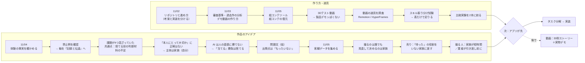
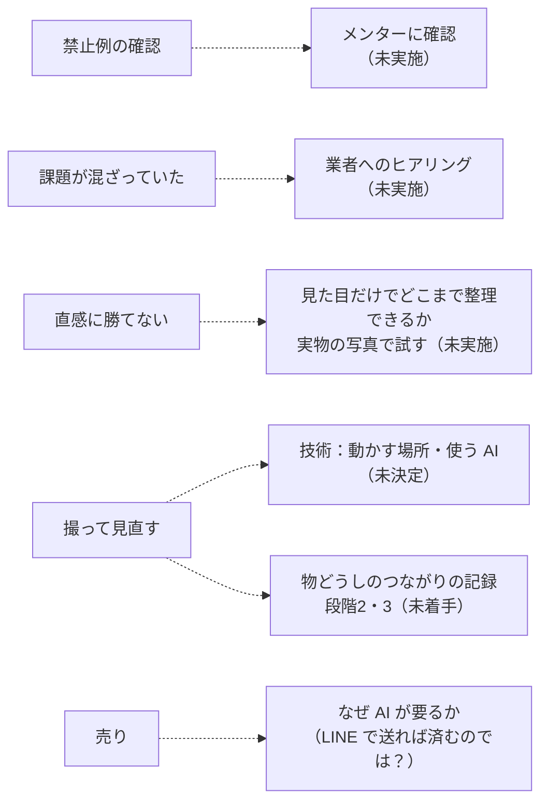
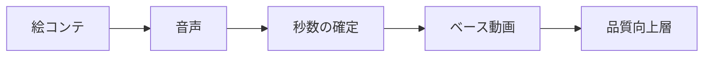

# 設計と考えの流れ

日付ごとに、何を考えて何を決めたか。詳しくは [decisions.md](decisions.md) と [log/](log/)。
GitHub ではこのまま図として表示される。

流れは2本並んで進んだ。**作り方・道具**（動画の仕組みなど）と、**作品のアイデア**。

- 作品のアイデアの詳しい図（地点19・枝21、採らなかった枝・止まっている枝つき）は、PC の `試作/1104_アイデアの土台固め/考えの遷移.html`（PCのみ）。家族の私的な事情を含むので、ここには粗い流れだけを置く
- 図の正本をどちらにするかは未決定（[log/2026-11-05.md](log/2026-11-05.md) の提案を参照）

## 全体（2本の流れ）

## 作品のアイデア：止まっている枝（未完）

## 作品のアイデア：採らなかった・保留した枝

| 枝 | どうしたか | 理由 |
|---|---|---|
| 訪問購入を課題にする | 採らない | 業者が家で買い取る取引で、別の話 |
| 業者を主役にする | 発展として保留 | 業者側の裏付けが体験から取れない |
| 友人のケース（連絡・承認の管理） | 発展として保留 | 既存の道具でも解ける。混ぜると汎用ツールに寄る |
| 承認・待ち・廃棄・保留の4枠ボードだけ | 採らない | 一般的な管理ボードに見える |
| AI が人より早く大切な物を見つける | 採らない | 勝てる根拠もデータもない |
| 「残す候補と根拠」を中心にする | 採らない | 裏付けがなく、「見直すための索引」に置き換えた |
| 「見落としに気づける」を売りにする | 採らない | 自分の体験では見落としは起きていない（自分がいたから） |

## 動画を作る順（idea/demo-video-pipeline.md より）

